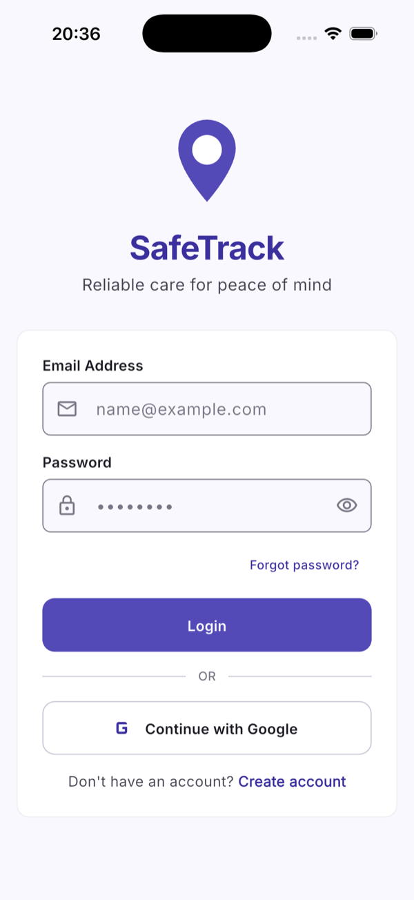
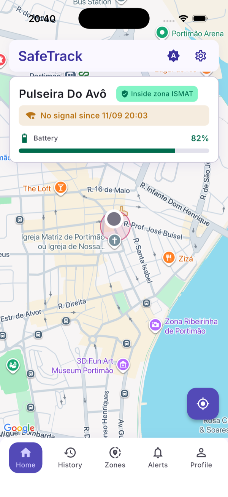
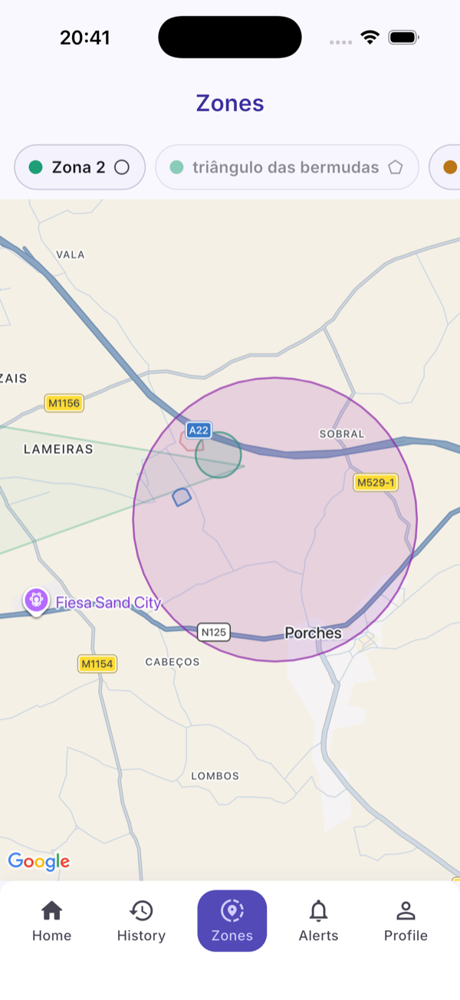
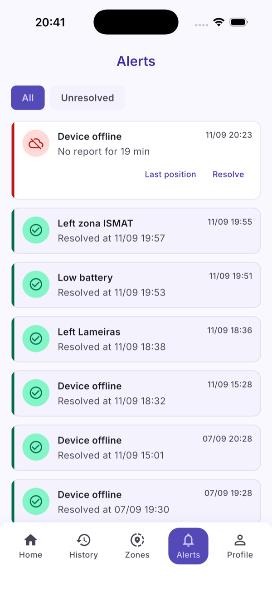

# SafeTrack

GPS tracking with geofencing for vulnerable people, such as elderly people
with dementia or young children. Final year project for the Computer
Engineering degree at ISMAT (Portugal), 2025/2026.

The system has three parts: a GPS tracker with a cellular connection, a
Firebase backend, and a Flutter app for the caregiver. The caregiver is
alerted when the tracker leaves its safe zones, runs low on battery or stops
reporting.


<p>
  
  
  
  
</p>

Full report (Portuguese): [docs/Relatorio-TFC-SafeTrack.pdf](docs/Relatorio-TFC-SafeTrack.pdf)

## Repository layout

| Folder | Contents |
| --- | --- |
| [`firmware/`](firmware/) | C++ / PlatformIO firmware for the LilyGO T-SIM7000G (ESP32, GNSS, LTE-M, MicroSD) |
| [`functions/`](functions/) | Firebase Cloud Functions (Node.js): telemetry ingestion, geofencing, device health and notifications (FCM and Telegram) |
| [`app/`](app/) | Flutter app (iOS) with Google Maps and Firebase Auth |
| [`simulator/`](simulator/) | Node.js device simulator and end-to-end, security and load test scripts |

The tracker posts its position over HTTPS to an HTTP function. Each stored
point triggers the zone and health checks, which create or resolve alerts and
notify the caregiver. The app reads everything from Firestore in real time.

## Features

- Multiple circular or polygon zones per device. The device is safe while it
  is inside at least one active zone.
- Haversine distance and ray casting, shared by the backend and the app. An
  alert needs two consecutive readings outside, so a single bad fix is ignored.
- Exit, low battery (with hysteresis) and offline alerts.
- Indoor positioning: without a GNSS fix the device sends a Wi-Fi scan, which
  the backend resolves with the Google Geolocation API. Imprecise positions
  that still overlap a zone do not trigger alerts.
- Points that cannot be sent are queued on the MicroSD card and sent later in
  order.
- Device pairing with a PIN, enforced by the Firestore security rules.

## Engineering notes

- **GNSS and cellular interference.** The cellular transmitter desensitizes
  the GNSS receiver on the same board. The firmware first tries for a fix with
  the radio on, then switches to airplane mode only if needed, and keeps the
  modem and network registration alive between cycles.
- **TLS on the SIM7000G.** Firmware R1529 fails to connect whenever a CA
  certificate is configured. The diagnostics build tests each candidate root;
  the device uses TLS without server validation and authenticates with a
  shared key.
- **Security rules.** The security tests act as an untrusted REST client. They
  found that any signed-in user could create a device document and claim an
  unprovisioned id; device creation is now limited to the Admin SDK.

## Tests

- Backend: unit tests (`node --test`) and an integration test against the
  Firestore emulator.
- App: unit and widget tests, with `fake_cloud_firestore` for the services.
- GitHub Actions runs the backend tests, `flutter analyze` and `flutter test`
  on every push.
- The simulator includes alert lifecycle, security, pairing and load tests
  against a deployed project.

## Setup

Keys and credentials are not committed. Each one has an example file:

| Local file | Example |
| --- | --- |
| `functions/.env` | [`functions/.env.example`](functions/.env.example) |
| `firmware/src/config.h` | [`firmware/src/config.example.h`](firmware/src/config.example.h) |
| `app/lib/config/secrets.dart` | [`app/lib/config/secrets.example.dart`](app/lib/config/secrets.example.dart) |
| `app/ios/Runner/GoogleService-Info.plist` | [`GoogleService-Info.example.plist`](app/ios/Runner/GoogleService-Info.example.plist) |
| `app/ios/Flutter/Secrets.xcconfig` | [`Secrets.example.xcconfig`](app/ios/Flutter/Secrets.example.xcconfig) |

Set your project ID in [`.firebaserc`](.firebaserc), then see
[`functions/README.md`](functions/README.md),
[`app/README.md`](app/README.md) and
[`simulator/README.md`](simulator/README.md).

## Data model (Firestore)

```
users/{userId}                        fcmToken, telegramChatId
devices/{deviceId}                    ownerId, name, pairingCode, batteryLevel,
                                      lastSeen, alertActive, outsideCount,
                                      offlineAlertActive, lowBatteryAlertActive
devices/{deviceId}/telemetry/{id}     lat, lng, battery, timestamp, receivedAt,
                                      source (gps|wifi), accuracy
devices/{deviceId}/geofences/{zoneId} name, type (circle|polygon), center and
                                      radius or vertices[], active, color, createdAt
alerts/{id}                           deviceId, type, timestamp, resolved, lat, lng
```

Alert types: `geofence_exit`, `low_battery`, `offline`.

## Author

Daniel Balicevic. Supervisor: Prof. Tiago Candeias.
